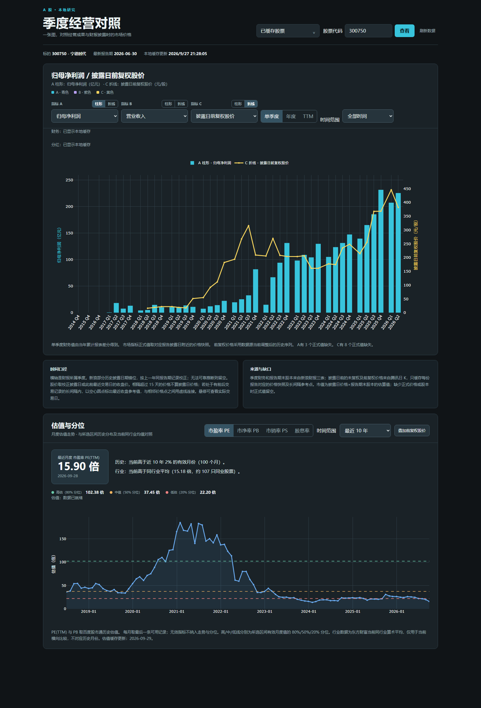

# A 股分析工具

本地运行的 A 股分析工具，提供企业经营趋势、财务三表、估值、筹码、行业对比和投资 checklist。数据保存在本地 SQLite，支持独立刷新、备份与恢复。

## 项目演示

1 分 37 秒了解主要功能，视频配有中文字幕。

https://github.com/user-attachments/assets/500b5d06-85d4-4666-b1f2-60e4c5a677c1



截图以 300750 宁德时代为例，数据和缓存日期仅代表截图时状态。

## 主要功能

- **企业经营趋势**：A／B／C 独立选择 18 项指标及柱形／折线，支持单季度、年度、TTM 和历史范围筛选，包括主营现金流、季末市值及披露日估算市值。下方提供估值历史、分位／标准差参考线和筹码趋势图。
- **财务分析**：按报告期查看资产负债结构、利润与现金流瀑布及完整三表，支持累计／单季、比较期、金额单位与来源展开。
- **主营构成**：按产品、行业和地区查看收入／成本／毛利规模、来源占比、同期增长及毛利率，支持累计报告类型、统一／原始名称、归并依据、项目筛选和完整明细；口径与限制见[主营构成页面说明](docs/business-segments-page.md)。
- **DCF 参考试算**：支持标准及三阶段成长模式，提供10年简化现金流折现、三情景、预测图、敏感性矩阵和参数依据；口径与限制见[DCF 说明](docs/dcf-valuation.md)。
- **我的股票**：按代码、名称或拼音搜索，管理分组和组内顺序；全拼及首字母预先保存在 SQLite，页面只读；支持取消关注与恢复，历史资料按维护规则保留。
- **投资笔记**：一只股票一个 Markdown，按日期随手记录，自动保存、编辑／预览切换，可插入本地单项数据或表格；三个个股页面提供快速入口，后台维护可设置存储目录。见[投资笔记说明](docs/investment-notes.md)。
- **行业分析**：公司对比、行业汇总、排行和趋势，财务与市值分别更新。
- **Checklist、经营判断与 AI 研报**：18项定性checklist；经营判断通过联网检索、严格结构化分析两阶段生成，后台绑定来源，提供三张前置表、行业地位附表、明确结论与独立历史，共用AI设置；AI研报入口浏览项目技能已生成的本地HTML。仅明确生成才使用模型额度。
- **后台维护**：查看数据库用途、记录数与占用，管理备份、恢复、未关注股票清理及数据库空间整理。

行业数据、指数图表及维护统计的内存缓存，在最后一次实际读取后闲置一小时会自动清除；正常约30秒检查一次，正在使用时顺延。再次打开从本地资料重建，已保存数据不受影响。持续使用会续期；关闭浏览器后后台仍可执行清理。清除缓存不保证进程内存立即回到启动值。

前台请求空闲一小时且没有采集或模型任务时，后台还会每小时尝试回收Python临时对象和Windows未使用的堆内存，即使没有过期缓存也会检查。日志记录真实工作集和私有提交前后变化；运行中的原生库仍会占用内存。

指标的含义、计算公式、来源表／字段、周期和缺值规则统一见[企业经营趋势指标说明](docs/enterprise-trend-metrics.md)。

## 启动

需要 Python 3.10 及以上。在仓库根目录运行：

```powershell
python -m pip install -r requirements.txt
python app.py --port 8765 --open-browser
```

打开 [http://127.0.0.1:8765/](http://127.0.0.1:8765/)，指定股票可访问 [宁德时代页面](http://127.0.0.1:8765/?code=300750)。服务只监听本机；在启动窗口按 `Ctrl+C` 停止。日常使用及修改后的人工验收统一使用 8765 和原数据库；隔离测试服务须显式指定其他空闲端口。

Windows 可双击 [start_dashboard.bat](start_dashboard.bat)。脚本依次使用 `PYTHON_EXE`、项目 `.venv`、PATH 中的 Python 或 `py -3`，检查环境后启动；可传入启动参数，关闭窗口即停止服务。

Windows 也支持无黑窗托盘启动。先在项目目录安装桌面依赖并创建快捷方式：

```powershell
python -m pip install -r requirements.txt -r requirements-desktop.txt
powershell -NoProfile -ExecutionPolicy Bypass -File scripts/create_desktop_shortcut.ps1
```

双击桌面的 **A-Stock Analysis**，后台就绪后自动在默认浏览器打开页面。关闭浏览器后后台继续运行；右键托盘图标可打开页面、查看运行状态、打开日志目录、重启后台或退出。再次双击快捷方式只唤起原实例。退出或重启时若仍有页面请求、采集、分析或维护任务，会提示稍候或先在页面停止任务。

开发完成后使用托盘的 **重启后台**：先安全停止原后台，再启动同环境的新 Python 进程，加载最新代码并保留原端口。重启不额外打开浏览器标签，后台就绪后刷新原页面即可；启动和恢复过程中不允许重复重启。若新进程启动失败，会提示使用桌面快捷方式重新启动。

开发验收也可在项目目录运行 `python -m stock_analysis.desktop.restart`。命令将请求交给当前 Windows 会话的托盘实例，后台按原流程检查活动任务并重启。请求处理结果和启动状态见 `desktop.log`。

快捷方式直接使用同环境的 `pythonw.exe`，托盘与后台共用一个 Python 进程。首次从旧命令行后台切换，先确认任务完成并按 `Ctrl+C` 安全停止原后台。日志位于 `data/verification/logs/desktop.log`，最多保留当前日志和三个轮转文件，每个约 2 MiB。HTTP访问只记录400及以上的失败响应（未知状态仍保留），省略正常访问和重定向；启动、重启、任务及异常日志继续记录，认证回调参数继续屏蔽。启动失败会显示错误提示。依赖缺失需手动安装，不自动联网修复。

脚本可通过 `-PythonExe '完整的 python.exe 路径'` 指定环境，或用 `-ShortcutDirectory '已有目录'` 指定快捷方式位置。它只创建快捷方式，不启动程序、不设置开机自启。托盘入口为 [desktop_app.pyw](desktop_app.pyw)，命令行入口继续保留。

Plotly 由本地 Python 包提供，不依赖 CDN；首次取数和后续更新需要访问外部数据源。完整依赖见 [requirements.txt](requirements.txt)。

## 数据与连接

正常业务从 `data/stock_analysis.sqlite3` 读取，旧 JSON 用于导入与保留原始备份。财报、价格、分红、估值和筹码按各自流程更新；请求失败时保留已验证记录并显示警告。

`data/` 不随 Git 同步。换电脑前使用[SQLite 备份与恢复](docs/sqlite-storage.md#维护命令)；SQLite 备份不含正式财报 PDF，完整资料迁移见[checklist 说明](docs/ai-stock-assessment.md)。清理资料或整理数据库空间使用后台维护入口，规则见[后台维护说明](docs/database-maintenance.md)。

数据源默认直连，不继承系统／环境代理。需要代理时，在启动窗口显式配置后重新启动：

```powershell
$env:DASHBOARD_USE_SYSTEM_PROXY = "1"
$env:HTTP_PROXY = "http://127.0.0.1:7890"
$env:HTTPS_PROXY = "http://127.0.0.1:7890"
python app.py --port 8765 --open-browser
```

HTTPS 证书验证保持启用；代理地址应按实际环境设置。

## 文档导航

| 文档 | 内容 |
|---|---|
| [企业经营趋势指标说明](docs/enterprise-trend-metrics.md) | 第一个 tab 的 18 项对照指标、估值及筹码：含义、公式、来源、周期、缺值与限制 |
| [财务分析说明](docs/financial-analysis.md) | 第二个 tab 的三表分析、来源展开和金融企业口径 |
| [股息率预测计算器](docs/dividend-forecast.md) | 当前及未来两财年的利润、分红、三情景、FCF覆盖与目标股息率参考买入价 |
| [财务四表数据字典](docs/financial-data-dictionary.md)／[CSV 清单](docs/financial-data-dictionary.csv) | 新浪原始科目、字段码、口径及覆盖统计 |
| [设计文档](docs/architecture-design.md) | 代码职责、加载、同步、缓存及备份流程 |
| [SQLite 存储说明](docs/sqlite-storage.md) | 表结构、迁移、同步和维护命令 |
| [后台维护说明](docs/database-maintenance.md) | 统计、取消关注、数据清理与空间整理 |
| [行业数据说明](docs/industry-data-schema.md) | 行业分类、财务及市值数据结构与取数规则 |
| [指数估值采集说明](docs/index-data-collection.md) | 统一宽基／行业／策略估值、日月频口径、限速与分段恢复；主页“指数估值”入口 |
| [Checklist 说明](docs/ai-stock-assessment.md) | 手动生成、正式财报、历史和完整资料备份 |
| [经营判断说明](docs/business-judgment.md) | 联网结论表、改变条件、独立历史与共享 AI 设置 |
| [项目研报技能](.agents/skills/a-share-value-research/SKILL.md) | 公司价值研究与 Markdown／HTML 研报生成 |

## 开发检查

```powershell
python -m pip install pytest
python -m pytest tests -q
```

自动测试使用隔离临时数据库。前端回归还需要 Node.js，部分真实浏览器测试需 Edge；测试端口须与日常后台分开。运行与项目维护约定见 [AGENTS.md](AGENTS.md)。

- [中远海控利润预测：正式数据、三情景与版本复盘](docs/shipping-forecast.md)（601919经营趋势历史表下入口，来源采集统一在采集管理）。

## 代码组织

Python 主包为 `stock_analysis`：`domains/` 按业务主题组织，`http/` 处理后端 HTTP，`collection/` 提供公共采集，`infrastructure/` 提供数据库与网络基础，`maintenance/` 负责维护。前端资源位于仓库根 `web/`。启动命令保持 `python app.py --port 8765 --open-browser`。具体迁移阶段和映射见[目录整理计划](docs/plans/20261025_代码目录结构整理/PLAN.md)。
